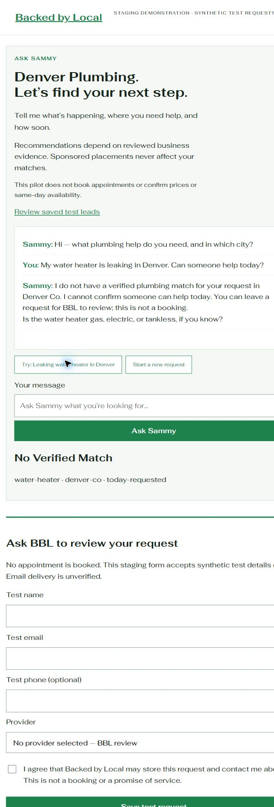
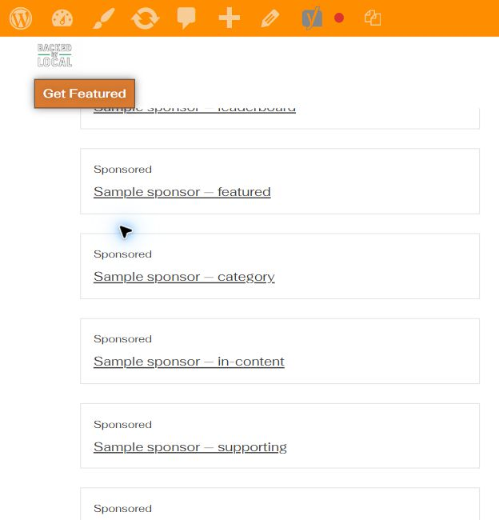

# BBL Sammy staging Phase 1

The recovered BBL MVP endpoint was disconnected from the homepage's canned Sammy replies. This isolated WordPress package connects the recovered interface conventions to `/bbl/v1/answer`, preserves conversation slots on the server, checks scoped business evidence, and persists consented test requests before attempting notification.

This folder is independent of the repository's automotive Fastify application. It does not change that application, deploy workflows, LocalParts, or production WordPress.

## Demonstration

- [Denver Plumbing staging journey](https://backedbylocal.com/backed-by-local/category/home-services/plumbing/)
- [Plain-permalink fallback](https://backedbylocal.com/backed-by-local/?bbl_sammy=1)
- [Saved test leads](https://backedbylocal.com/backed-by-local/wp-admin/tools.php?page=bbl-sammy)

Sign in as a staging WordPress administrator. This is a protected synthetic-test pilot, not a public customer launch. Enter “My water heater is leaking in Denver. Can someone help today?” and then “It is electric.” The backend retains `water-heater`, `denver-co`, `today-requested`, and `electric`. With current records it returns **No Verified Match** and never promises same-day availability.

## Dependencies and reviewed changes

Requires WordPress core and PHP 7.4+. No CPT UI, ACF, Code Snippets, AI credential, or additional third-party plugin installation is required. Version 0.4.1 is the single BBL plugin installed on staging.

Missing `business` and legacy `cities` post types and `bbl_category`, `bbl_city`, `business_category` taxonomies are registered in memory from the recovered model. Existing registrations are not replaced. No terms, businesses, pages, taxonomy relationships, ACF data, or schema tables are created or migrated.

Server conversations use 24-hour transients. Test leads are stored atomically as complete, non-autoloaded `bbl_p1_lead_<id>` options. Lead IDs derive from the server-owned conversation/version, making repeat submissions idempotent. No customer data was imported. Notification contains a synthetic-test label and lead ID, not contact details. Test leads remain available after plugin deactivation; retention is a launch gate.

The named clone's clean paths originally reached the production front controller and returned a 404. A reviewed Tools action created only `backed-by-local/category/home-services/plumbing/index.php` with the following content:

```php
<?php
// BBL staging-only plumbing entry. Loads this clone, never the production root.
require dirname(__DIR__, 3) . '/index.php';
```

Entry SHA-256: `4e642c6e840b4d01a73117a324a469905f71d9dfa2500417054fc9d8a58c5e1d`. The installer refuses existing files and symlink path components. It does not edit `.htaccess`, the production front controller, global permalink settings, or taxonomy rewrites. This is a scoped pilot entry, not a general category-routing solution.

The plugin remains inert unless both the configured home URL is exactly `https://backedbylocal.com/backed-by-local` and the WordPress root directory is named `backed-by-local`. REST access requires administrator capability and WordPress cookie/nonce authentication. The frontend uses text nodes for model-independent answers.

## Evidence contract

Matching reads published `business` posts and existing `bbl_city` and `bbl_category` terms. `phone_number` is supported with legacy `bbl_phone` fallback. A candidate must be in the requested city and plumbing category. Verification additionally requires `_bbl_evidence` metadata containing:

```json
{
  "status": "verified",
  "source_url": "https://provider.example/evidence",
  "reviewed_by": "internal reviewer reference",
  "checked_at": "ISO date",
  "expires_at": "ISO date",
  "cities": ["denver-co"],
  "services": ["water-heater"]
}
```

This is a **new explicit validation contract**, not a claim that recovered business records contained these fields. No records were marked verified during implementation. Missing or expired scope evidence is Possible. Missing request slots are Needs Clarification. No eligible records is No Verified Match. Generic plumbing evidence cannot establish water-heater capability. Verified records sort alphabetically, then by ID; sponsorship, featured flags, and static trust scores never enter ranking. Availability always remains unverified in this pilot.

The parser is deterministic and deliberately limited to the plumbing pilot. It reuses the MVP's intent/category/city architecture while removing the silent Lynnwood default, guessed radius coverage and generative recommendations. Broader free-form intent understanding, more ZIP mappings, ambiguous/negated statements, evidence editing workflows, and public abuse controls need further work before launch.

## Validation

Run `php tests/run.php` from this directory and `node --check bbl-answer-engine-mvp/sammy.js`. PHP syntax-check all plugin files as well.

47 application contract tests pass: intent/follow-ups/corrections, evidence scope/expiry, unpublished providers, sponsor independence, route isolation, legacy-registration preservation, production blocking, access control, consent/contact validation, stale versions, provider forgery, storage failure, mail failure/exception, idempotency, unverified acceptance, failed status persistence, and scoped route installation. These tests use explicit WordPress doubles, not a full WordPress integration harness. Live staging validation supplies real REST, WordPress persistence and browser smoke evidence.

The synthetic live lead `a542a06da9294740cd90d2bb` was saved on 2026-11-20 at 19:57:31 UTC and independently read from the admin page. It contains the two-turn request, contact fixture, intent, null provider, consent version/text/time, source and timestamp. Delivery status is **failed**, `delivery_verified=false`. Mail failure did not lose the request. SMTP configuration remains unchanged: Site Mailer and WP Mail SMTP are both active, Site Mailer is disconnected, and WP Mail SMTP was configured with Default (none).

Homepage main HTML was identical before/after (26,010 characters). All six Sponsored placements were identical: leaderboard, featured, category, in-content, supporting, footer. Neither sponsorship settings nor AdSense settings were changed. Staging currently has zero business posts and zero BBL category terms; the production 62-category hierarchy was not imported. No eight-category migration or full legacy-content restoration is claimed. The recovered original Denver guide/drafts remain preserved locally, not overwritten or published. Responsive inspection found no horizontal document overflow at the tested narrow viewport.





## Provenance

Source package: 14 recovered files, all SHA-256 checks passed before implementation. Original MVP 0.3 PHP is archived unmodified in `recovered-v03.php.txt`; SHA-256 `207663d2eda5f43b7df16bd1e29a3bd08dfa10cbf4a2c10be3c82d4cdfb22fca`. It was read from the production WordPress plugin editor on 2026-11-20. It is not loaded by the plugin. The recovered homepage Sammy section supplied `sammy-box`, `sammy-layout`, `sammy-copy`, `sammy-chat`, `sammyOutput`, `sammyInput` and `sammyAsk` conventions, Fahkwang, green #1e824c and square corners. Its canned `getAnswer` is replaced with authenticated REST calls. Native Elementor metadata was not available and is not represented as restored. The broad production REST authentication snippet was intentionally not installed.

## Rollback

1. On **staging only**, deactivate BBL Answer Engine MVP — Staging Phase 1. This stops the endpoints, route renderer and fallback registrations without deleting leads or business/taxonomy data.
2. Archive the newly created `backed-by-local/category/home-services/plumbing/index.php` after verifying the exact SHA above. Do not remove pre-existing directories, change production routing, or delete lead options. The physical entry otherwise remains a loader for the clone even while the plugin is inactive.
3. To restore this version, upload the packaged plugin and reactivate on staging. Existing lead options remain available. Do not refresh staging or import production databases.

No uninstall hook, term deletion, bulk import, automatic mail resend, production deployment, merge, or publication is included.

## Production readiness — not approved for launch

- Obtain and independently verify real provider, service and service-area evidence; add a review UI and audit trail.
- Configure one authenticated mail transport, remove the conflict under review, and prove actual receipt at info@backedbylocal.com. Never equate `wp_mail=true` with delivery.
- Add public-user session/authentication design, abuse limits, concurrent-turn control, retention/deletion policies, and privacy review before removing administrator-only access or synthetic labels.
- Extend intent handling beyond this scoped pilot and test ambiguity, negation, location changes and dangerous/emergency inputs.
- Complete native Elementor/ACF recovery and a separately reviewed taxonomy/content restoration if needed; preserve My Cities and original Denver assets.
- Replace the scoped pilot entry with reviewed general routing if expanding categories. Verify routing, accessibility, mobile layouts and failure/retry behavior with a full WordPress integration test environment.
- Recheck all sponsorship positions, advertising-disabled controls, existing business records, homepage and legacy links.
- Review this PR and rollback evidence; obtain explicit approval before production deployment, publication or merge.
